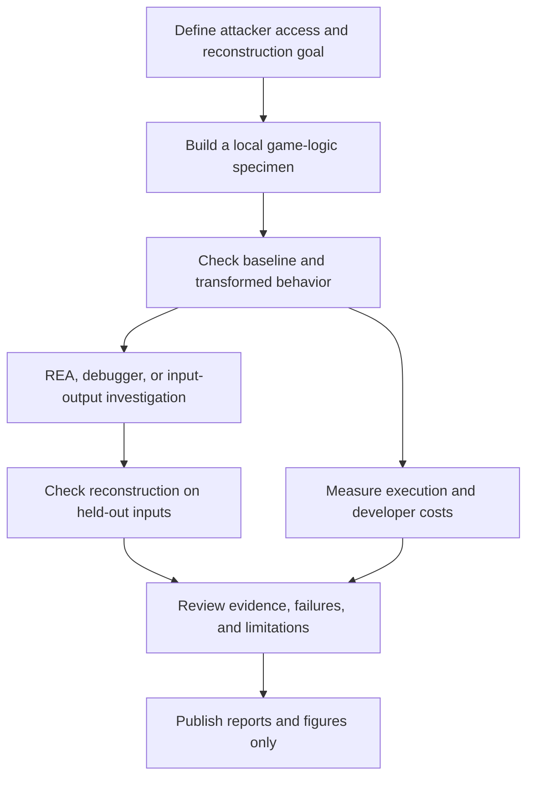

# Offline Game Protection Research

Experimental research into offline game protection, REA-assisted reconstruction, and the cost of hiding game logic and runtime state.

[Latest study](reports/RESULTS_MEMORY_BOUNDARY.md) · [Research reports](#research-reports) · [Evaluation workflow](#evaluation-workflow) · [Threat model](reports/FUNDAMENTAL_ANALYSIS.md)

The project evaluates small, privately held game-logic prototypes using REA, Ghidra, debugger observations, and held-out behavioral checks. It records reconstruction outcomes alongside execution costs and developer observations. **None of the tested prototypes has demonstrated that copying or reconstruction is impossible.**

This repository publishes reports and figures. Experimental source code, executables, reconstruction programs, and raw memory captures remain private.

## What has been evaluated

| Area | Completed work |
| --- | --- |
| Code transformations | Manual samples of function splitting, data encoding, a simple VM, permuted lookup tables, and build-specific representations. |
| Reconstruction | REA/Ghidra investigations and separate AI-agent evaluations that received binaries and interface descriptions without the original source or conversation history. |
| Observation limits | Static analysis, input-output observation, and selected debugger probes of stateful game logic. |
| Runtime state | Two-share storage with changing masks, state-object snapshots, and register observations in a stripped executable. |
| Execution costs | Repeated microbenchmarks and synthetic update workloads in a small terminal game or state-transition harness. |
| Developer experience | Sample compile/link timings, breakpoint and call-stack checks, and notes on generated-source debugging. |

These are sample-specific experiments. They do not establish compatibility with arbitrary games, protection strength for a whole game, or the effectiveness of commercial protectors. The evaluators' file-access restrictions were instruction-based, not enforced by an OS sandbox.

## Latest finding: changing storage does not change observation rights

The latest prototype stored each internal value as two 32-bit shares. A direct word search did not find the original RNG value in the observed state objects, but summing the shares recovered every sampled value. The decoder also exposed the value in a CPU register in a stripped executable.

| Check | Observed result |
| --- | --- |
| Original RNG word found directly in masked state objects | 0/80 snapshots |
| Original RNG recovered by adding the shares | 80/80 snapshots |
| Separate REA reconstruction, checked on held-out scenarios | 149/149 matches |
| Synthetic update-bundle median: original / masked | 0.88 / 1.88 μs |
| Persistent state object: original / masked | 28 / 44 bytes |

Snapshots covered one state object at consecutive update boundaries, not all process memory. Execution time is a synthetic workload measurement, not FPS. The reconstruction trial had one evaluator and does not prove equivalence for every input.

See the [memory-boundary study](reports/RESULTS_MEMORY_BOUNDARY.md) for the setup, stripped-binary probe, correctness checks, and limits.

## Evaluation workflow

Each report identifies whether an evaluator had already seen the source, which observations were allowed, and which inputs were reserved for later checking. Early source-aware trials are recorded separately from later evaluations without source disclosure.

Execution measurements use repeated runs and state their workload and aggregation method. Values from different studies are separate measurements; compare variants within the same study rather than treating all reports as one controlled benchmark.

## Research reports

| Study | Question | Observed outcome |
| --- | --- | --- |
| [Initial comparison](reports/RESULTS_2026-10-28.md) | What do simple control-flow and VM samples expose? | Core logic or interpreter data remained visible; VM execution cost increased. |
| [Existing techniques](reports/RESULTS_EXISTING_METHODS.md) | How do manual splitting and encoding samples behave? | Source-aware reconstructions matched held-out inputs; costs varied. |
| [Terminal game](reports/RESULTS_TERMINAL_GAME.md) | What changes when the same logic is linked into a playable sample? | Scripted final states matched; update and debugging costs were observed. |
| [Lookup-table candidate](reports/RESULTS_TABLE_CANDIDATE.md) | Does permuting a precomputed rule prevent reconstruction? | An evaluator extracted the table and reproduced its behavior. |
| [Build diversification](reports/RESULTS_DIVERSE.md) | Does a different binary representation prevent reuse? | A reconstruction from one variant also matched a second variant. |
| [Stateful observations](reports/RESULTS_STATEFUL_ATTACKS.md) | What can static analysis and limited input-output access reveal? | REA reconstruction matched all test scenarios; the limited black-box attempt was incomplete. |
| [Memory boundary](reports/RESULTS_MEMORY_BOUNDARY.md) | Can changing state storage prevent observation? | Shares and register values exposed the state; the prototype was reconstructed. |

The [foundations report](reports/FUNDAMENTAL_ANALYSIS.md) distinguishes file copying, binary-assisted reconstruction, and behavior-based reimplementation.

## Validation boundaries

- Matching a finite test set is evidence of observed agreement, not a proof of equivalence for every input.
- A successful decompilation, a larger control-flow graph, or different binary hashes alone do not measure reconstruction resistance.
- One evaluator per condition, concurrent workloads, unequal tool budgets, and instruction-based access restrictions limit several studies.
- Terminal-game and synthetic update timings do not establish frame rate, loading performance, or player experience in a commercial engine.
- Full engine integration, source-level debug mapping, update compatibility, and developer task time remain unmeasured.
- Hardware isolation and fully homomorphic encryption were researched but not security-tested here. The checked WSL environment did not expose the required hardware interfaces.

Private experimental artifacts limit independent reproduction. These are preliminary reports with documented constraints, not a security certification or a reproducible benchmark distribution.

## Current direction

The research now focuses on **which information an attacker can observe and what enforces that boundary**. Planned work includes stronger evaluator isolation, repeated trials with equal resource budgets, broader game workloads, and a separate evaluation of hardware-backed boundaries where suitable hardware is available.

The long-term objective is useful offline protection with practical game performance and manageable developer costs. No completed result establishes a general solution to offline game copying.

## Related work

- [REA](https://github.com/morluto/rea): the analysis interface used in reconstruction experiments.
- [Ghidra](https://github.com/NationalSecurityAgency/ghidra): the native-analysis provider used with REA.
- [Tigress transformations](https://tigress.wtf/transformations.html): references for established transformation families. The manual samples are not Tigress-generated outputs.
- [BTG Packer](https://github.com/uzokingkong/BTG-packer): a reference for this README's technical organization. BTG itself has not been evaluated in these studies.

Public changes are limited to reviewed Markdown reports and figures. Internal implementation and diagnostic artifacts remain outside the publication checkout.
