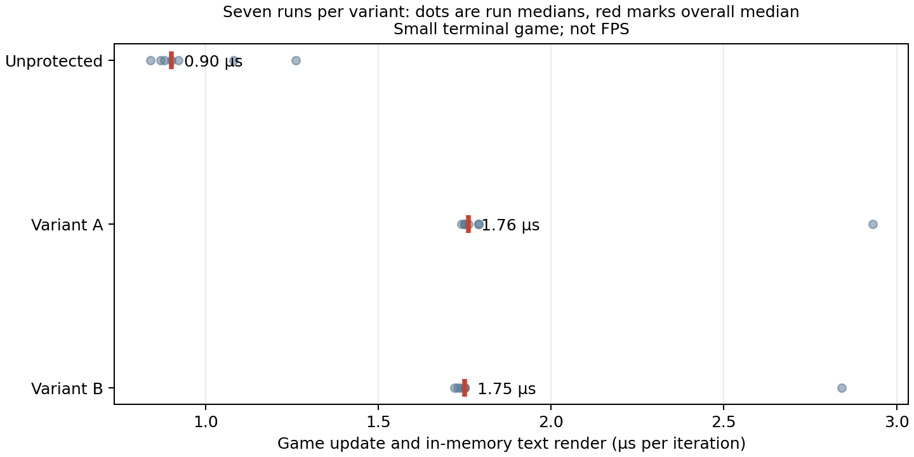

# 선택적 다양화 시제품과 기초 관찰 실험

2026-10-28 · 공개 연구 기록. 소스와 바이너리는 공개하지 않는다.

## 결과

한 개의 게임 로직에 한정된 생성기를 만들어 연산을 여러 단계로 분리하고 시드별 데이터 표현과 분기 상태를 바꿨다. 임의의 게임이나 C 함수를 자동 변환하는 도구는 아니다. 두 시드의 바이너리 SHA-256은 서로 다르지만 이 사실 자체는 보호 효과를 입증하지 않는다. 세 가지 로직은 1,003개의 경계값·난수 입력에서 출력이 일치했다.

별도 평가자 두 명이 원본 소스와 대화 기록을 받지 않고 보호 없는 로직과 시드 101 로직을 각각 REA/Ghidra로 분석했다. 평가자는 각자 독립 프로그램을 작성했고, 주 평가자가 별도로 선정한 260개 입력에서 각각 원본과 일치했다. 시드 101을 분석해 작성한 재구현을 시드 202의 바이너리와 비교한 결과도 동일한 260개 입력에서 일치했다. 이것은 다른 빌드의 기계 코드 자체를 분석하지 않아도 같은 동작이 재현된다는 관찰이다. 모든 입력을 증명하지는 않는다.

분석 구역은 지시에 의한 제한이며 OS 차원의 접근 통제는 없다. 각 조건당 1회였고 서로 다른 평가자가 같은 호스트를 동시에 사용했다. 분석 시간은 각각 약 107초와 100초라는 평가자 보고가 있지만, 자원 경쟁·작업 방식·시행 착오가 다르므로 보호 강도나 시간 차이를 결론내릴 수 없다. 게임 전체가 아니라 단일 로직 실행 파일을 재구현했다.

## 게임 비용과 개발자 영향

동일한 작은 터미널 게임에서 200개 적, 6,000번 업데이트, 버전당 7회 무작위 순서로 측정했다. 매 실행의 중앙값을 다시 중앙값으로 요약했다. 메모리 내 텍스트 화면 생성까지 포함하며 입력·실제 출력·그래픽 표시를 제외하므로 FPS가 아니다. 자동 입력 후 최종 화면과 상태는 일치했다.

| 빌드 | 업데이트 중앙값 | 95백분위수 중앙값 |
| --- | ---: | ---: |
| 보호 없음 | 0.90 μs | 1.39 μs |
| 시드 101 | 1.76 μs | 3.23 μs |
| 시드 202 | 1.75 μs | 2.66 μs |

GCC 15.2.0 `-O2 -g`에서 게임 컴파일·링크 5회 중앙값은 기준 171.8ms, 시드 101 189.3ms, 시드 202 193.4ms였고 별도의 코드 생성 시간은 포함하지 않았다. 작은 단일 프로젝트 측정이므로 개발자 도입 비용으로 일반화할 수 없다. GDB에서 세 빌드 모두 중단점은 잡혔지만 보호 빌드는 생성된 C 소스에서 멈췄다. 자동 원본 매핑, 복잡한 오류 조사, 실제 엔진 및 플레이어 호환성은 미측정이다. 생성기와 두 실행 파일 빌드의 한 번 측정은 합계 약 408ms였다.

## 기초 관찰

실행 파일을 열지 않고 입력·출력만 관찰하는 예비 실험에서도, 출력 필드 배치와 계산식 후보 범위를 미리 알고 51회 질의한 뒤 300개 별도 입력에서 동일한 결과를 내는 식을 찾았다. 사전 지식과 작은 후보 공간에 크게 의존한 실험이라 일반 게임의 관찰 기반 복제 비용으로 해석할 수 없다. 다만 동일한 행동을 노출하는 한 코드 난독화와 별개로 공격자가 얻는 정보가 있음을 이 예제에서 보여준다.

**결론:** 이 시제품은 소스 비공개 REA 재구현을 막지 못했고, 다른 시드의 동일 동작에도 복원 결과가 적용됐다. 게임 업데이트 비용도 증가했다. 일반 난독화나 다양화 전체를 무효로 판정한 것은 아니다. 세부 위협 모델과 이론적 한계는 [기초 분석](FUNDAMENTAL_ANALYSIS.md) 참조.
