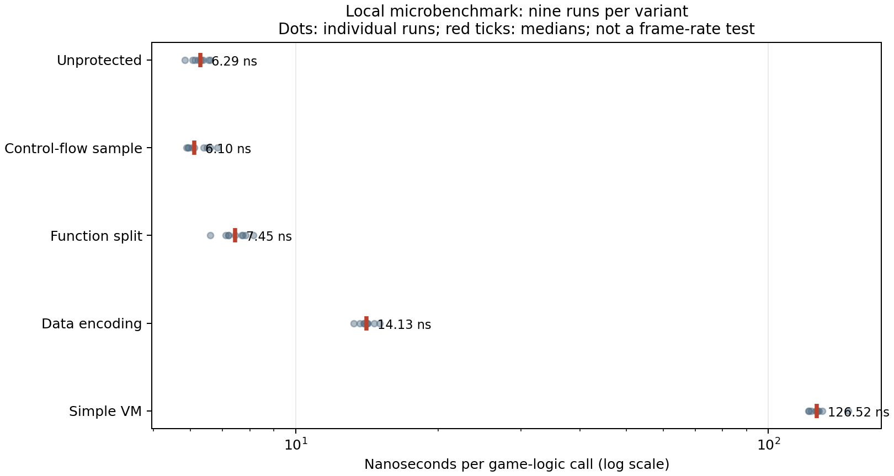

# 기존 오프라인 보호 방식 재검증 — 예비 결과

2026-10-28 · 공개 연구 기록. 내부 구현 코드와 바이너리는 공개 대상이 아니다.

## 질문과 실험 범위

기존에 연구된 코드 보호 방식이 REA 재구현과 정상 실행·개발에 미치는 영향을 살펴본다. 표본은 C로 만든 단일 게임 상태 전이 함수다. 실제 플레이 가능한 게임이나 상용 보호 제품은 아니다. 데이터 인코딩과 함수 분리는 참고 문헌에서 설명하는 범주의 수동 예제이며 Tigress를 실행한 결과가 아니다.

## 비교 결과

| 방식 | 1회 실행 중앙값 | 보호 없음 대비 | REA 및 재구현 관찰 |
| --- | ---: | ---: | --- |
| 보호 없음 | 6.295 ns | 1.00배 | 계산식 디컴파일; 재구현 일치 |
| 단순 제어 흐름 분리 | 6.100 ns | 0.97배 | 핵심 계산식 노출; 별도 재구현 시험 안 함 |
| 함수 분리 | 7.448 ns | 1.18배 | 분리된 각 계산 추적 가능; 재구현 일치 |
| 데이터 인코딩 | 14.128 ns | 2.24배 | 인코딩·복호화와 핵심 계산 추적 가능; 재구현 일치 |
| 단순 VM | 126.518 ns | 20.10배 | 해석기와 명령 데이터 읽힘; 재구현 일치 |

점은 9회 반복 측정값, 빨간 선은 중앙값이다. 가로축은 로그 눈금이다. WSL2 x86-64, GCC 15.2.0 `-O2`, 버전당 1천만 회의 반복 호출을 무작위 순서로 9회 측정했다. 출력 체크섬은 일치했다. 단일 함수 호출 성능으로, 프레임·로딩·게임 전체 CPU나 메모리 성능은 측정하지 못했다. VM 벤치마크는 별도 링크를 위해 내부 함수 가시성을 변경했으므로 배포 실행 파일과 기계 코드가 완전히 같다고 단정할 수 없다.

다섯 버전은 경계값과 난수 입력 1,004개에서 동일한 결과를 냈다. 보호 없음, 함수 분리, 데이터 인코딩, VM의 재구현은 별도 302개 입력에서 원본 실행 파일과 일치했다. **평가자가 실험 원본을 이미 알고 있었기 때문에 블라인드 시험이 아니고** 재구현 소요 시간·비용도 기록하지 않았다. 일치한 입력은 전체 입력 공간이 아니며 보호 강도의 통계적 비교도 불가능하다. REA 의사코드에는 일부 함수 인자 정보가 불완전한 부분이 있었다.

## 개발자와 플레이어에 미치는 영향

이 예제의 수동 코드 수정과 개별 컴파일은 실제 엔진용 통합 비용을 대변하지 않는다. 참고용 단일 컴파일 관찰은 보호 없음 68.8 ms, 흐름 65.4 ms, 함수 분리 78.2 ms, 인코딩 65.1 ms, VM 76.4 ms였다. 한 번의 측정이므로 차이를 결론으로 해석하지 않는다. 개발자의 코드 수정량·빌드 파이프라인·디버깅·업데이트 호환성은 측정하지 않았다.

플레이어 측에서는 로직 실행 시간의 차이를 관찰했지만 정상 게임의 프레임, 로딩, 저장, 충돌, 접근성·모드 호환성은 검증하지 않았다. 위 수치로 정상 플레이에 영향이 없다고 결론낼 수 없다.

## 해석 및 다음 단계

이번 단순 함수 분리·인코딩·VM 구현은 소스에 익숙한 평가자의 REA 보조 재구현을 막지 못했다. 단순 제어 흐름 예제는 REA에서 원래 계산이 노출됐고, 컴파일러가 정리한 것으로 추정하지만 최적화 단계 분석은 하지 않았다. 이는 구현 사례에 대한 관찰이지 보호 방식 전체에 대한 판정이 아니다. 실제 연구 도구의 다양한 설정을 적용하고, 소스에 접근하지 않는 평가자가 같은 시간·도구 예산으로 독립적이고 반복적인 재구현을 수행해야 한다. 정상 플레이와 개발자의 경험도 실제 게임 빌드에서 측정해야 한다.

## 근거

- [Tigress 공식 변환 목록](https://tigress.wtf/transformations.html): 가상화, 함수 분리, 데이터 인코딩 등.
- [Tigress 함수 분리 설명](https://tigress.wtf/split.html).
- [Tigress 데이터 인코딩 설명](https://tigress.wtf/encodeData.html).
- [Tigress 다운로드 및 사용 조건](https://tigress.wtf/download.html): 상업적 사용에는 별도 라이선스 조건이 있다. 본 실험은 Tigress를 설치하거나 실행하지 않았다.
- [난독화 평가 연구](https://www.mdpi.com/2076-3417/14/12/5056): 분석 저항성과 실행 비용을 별도로 평가하는 접근.
