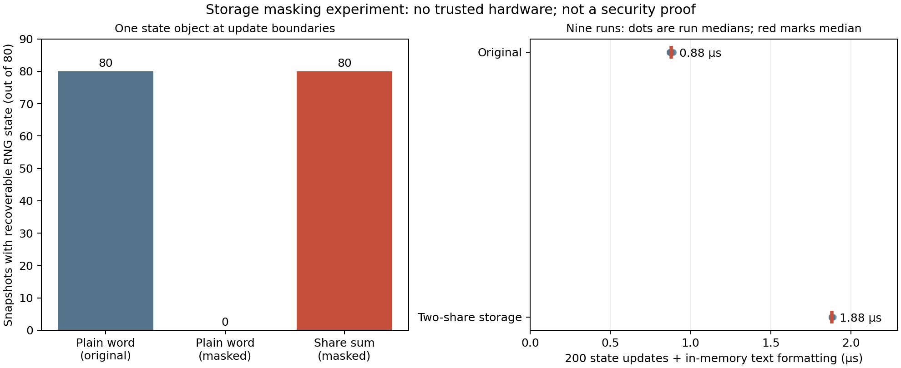

# 내부 상태 노출의 경계: 실제 관찰과 소스 비공개 재구현

2026-10-28 · 공개 연구 기록. 내부 소스·실행 파일·원시 덤프는 GitHub 공개 대상이 아니다.

## 결론

상태를 두 조각으로 저장하고 표현을 매번 갱신하면 이 실험의 단순 값 검색은 피할 수 있었지만, 두 조각을 함께 읽거나 연산 순간을 관찰하면 상태를 복원할 수 있었다. 소스를 받지 않은 평가자도 REA/Ghidra와 GDB로 심볼 없는 바이너리에서 복원 경로를 찾고 동작을 재구현했다. **이번 시제품은 내부 상태의 관찰을 차단하지 못했다.** 이것은 모든 가능한 소프트웨어 보호 방식의 불가능성 증명이 아니다.

현재 확인한 범위에서 관찰 권한 자체를 바꾸는 구체적인 후보는 신뢰 실행 하드웨어다. 현재 WSL에서는 지원 기능과 장치를 확인하지 못해 하드웨어 격리를 실제 시험하지 않았다. 따라서 이를 해결된 방법으로 보고하지 않는다.

## 실험한 방법과 위협 모델

원본 상태 전이 로직의 난수 상태·적 상태·연속 행동 횟수를 각각 두 개의 32비트 조각으로 저장했다. 두 조각의 합은 원래 값이며 마스크는 실행 시작 때 getrandom으로 초기화하고 이후 xorshift로 갱신했다. 갱신용 xorshift는 암호학적 난수기로 간주하지 않았다. 일부 선형 계산은 조각 상태로 수행하지만, 시프트·조건 계산을 위해 값을 합치는 지점이 존재한다. 이것은 암호화나 보안 격리 영역이 아니다. 일반 게임용 자동 변환기도 아니다.

공격자는 자신의 게임 프로세스를 디버거에서 실행하고 모든 조각과 레지스터를 관찰할 수 있다. 실험 GDB는 WSL 일반 사용자 UID 1000으로 동작했으며 관리자 권한이 필요하지 않았다. 게임 환경 밖의 계정·서비스·파일은 공격 대상이 아니다.

## 검증 결과

| 확인 항목 | 원본 | 두 조각 저장 |
| --- | ---: | ---: |
| 80개 상태 객체에서 원래 RNG가 단일 32비트 워드로 발견됨 | 80/80 | 0/80 |
| 조각을 합쳐 원래 RNG 복원 | 해당 없음 | 80/80 |
| 심볼 없는 배포 바이너리의 레지스터에서 상태 관찰 | 별도 시험 없음 | 성공 |
| 소스 비공개 REA 재구현 후 별도 입력 평가 | 비교군 이번 회차 없음 | 149/149 일치 |

상태 객체 관찰은 같은 seed=12345에서 80개 연속 update 진입 시점에 수행했다. 읽은 범위는 원본 상태 객체 28바이트, 변환 상태 객체 44바이트다. 전체 메모리·스택·레지스터를 스캔해 평문 부재를 증명한 것이 아니다. 수치는 일반적인 유출 확률이나 공격 성공률 통계가 아니다. 값이 0/80로 검색되지 않아도 구조와 관계를 알면 복원할 수 있었다.

디버그 빌드의 조각 합과 레지스터 관찰을 먼저 확인했다. 이후 별도 평가자가 REA로 발견한 주소를 이용해 심볼 없는 실행 파일의 0x4012e0에서 두 인자 레지스터를 읽고 두 명령을 진행했다. EAX는 87,628,868로, seed12345의 다음 RNG 상태와 일치했다. 이 두 번째 실험은 배포 바이너리의 심볼을 사용하지 않았다. 해당 주소는 이번 바이너리의 주소이며 다른 빌드에는 그대로 적용되지 않는다.

평가자는 소스와 대화 기록을 받지 않고 전달받은 바이너리만 분석했다. REA/Ghidra에서 공유합 복원 함수를 찾고, GDB로 메모리의 조각 합과 다음 RNG 레지스터를 관찰했으며, 원본 파일 없이 실행되는 Python 재구현물을 작성했다. 평가자 자체 비교 840개에서 일치했고, 주 평가자가 별도로 준비한 길이 0~512 행동과 경계 seed 총 149개에서도 JSON과 종료 코드가 일치했다. getrandom 실패 경로와 모든 입력 공간에 대한 증명은 포함하지 않는다. 각 평가는 한 번이며 접근 제한은 지시 기반이고 OS 파일 격리는 아니다. 평가자 보고 시간 3분33초는 일반적인 난도 지표로 사용하지 않는다.

기능 확인은 원본과 보호 버전의 224개 시나리오 비교 및 같은 입력을 다른 마스크로 10회 실행한 결과 일치로 수행했다.

## 실행·개발 비용

WSL2, GCC 15.2.0 `-O2`에서 동일 상태를 200번 업데이트한 뒤 메모리에 상태 문자열을 작성하는 묶음을 6,000회 실행했고, 각 버전을 무작위 순서로 9회 반복했다. 위 그래프 오른쪽 점은 각 실행의 중앙값이고 강조선은 그 중앙값이다. 실제 프레임, 렌더링, 입력 대기, 화면 출력을 측정한 것이 아니다. 초기 getrandom과 프로세스 시작도 반복 실행 시간에서 제외된다.

| 항목 | 원본 | 두 조각 저장 |
| --- | ---: | ---: |
| 업데이트 묶음 중앙값 | 0.88 μs | 1.88 μs |
| 95백분위수의 중앙값 | 0.93 μs | 1.93 μs |
| 상태 객체 크기 | 28바이트 | 44바이트 |
| 디버그 빌드 5회 컴파일 중앙값 | 91.5ms | 97.6ms |
| 코드·상수·데이터 등의 섹션 합계(size) | 2,600바이트 | 3,046바이트 |

묶음 실행 중앙값은 약 2.14배다. 컴파일 시간은 작은 단일 프로젝트 측정이며 수동 변환·디버깅·통합에 걸린 전체 시간을 의미하지 않는다. 원본 변수 대신 두 조각과 복원 관계를 디버깅해야 하며 원본 소스 매핑 기능은 만들지 않았다. 상용 엔진·세이브 형식·플랫폼 호환성과 실제 개발자 작업 시간은 미검증이다.

## 근본적인 문제를 다루는 후보

1. **소프트웨어의 상태 표현 변경:** 이번 시험에서 저장 형태를 바꿨지만 양쪽 조각과 계산 과정을 읽을 권한은 같았다. 두 조각의 합이라는 관계를 알면 단일 시점에도 복원할 수 있다. 복원 함수를 숨기는 것만으로 공동 관찰 가능성이 사라지지는 않는다. 이것이 이 시제품의 핵심 실패 원인이다.
2. **신뢰 실행 하드웨어:** SGX의 production enclave는 일반 메모리와 다른 하드웨어 관찰 경계를 제공한다. 다만 빌드 파일의 코드를 자동으로 암호화하는 기능과는 다르며, 프로그램 전달·키 공급·출력·부채널을 별도 설계해야 한다. 단순히 enclave에 코드를 넣었다고 복제가 불가능해지는 것이 아니다. 현재 WSL의 /proc/cpuinfo에 SGX 기능이 없고 /dev에 SGX 장치가 없었으며, /dev/tdx_guest와 /dev/sev도 없었다. Windows 호스트 전체나 모든 하드웨어의 지원 여부를 판정한 것은 아니다. 시뮬레이션을 보안 검증으로 대체하지 않았다.
3. **암호화 상태에서의 계산(FHE):** 조사한 TFHE 문서는 암호문 연산과 복호화용 client key를 분리한다. 이를 오프라인 게임 보호로 쓰려면 플레이어가 통제하는 실행 환경 밖에서 복호화 권한을 어떻게 지킬지, 동작에 필요한 출력은 어떻게 제공할지 정해야 한다. FHE가 암호화 데이터 연산을 지원한다는 사실만으로 알고리즘·게임 복제 방지가 보장되지는 않는다. 이번에 구현·벤치마크하지 않았고 보호 효과도 주장하지 않는다.

다음 설계의 기준은 마스크가 얼마나 복잡한지가 아니라, **어느 정보를 누구의 읽기 권한 밖에 두는지와 그 가정을 어떻게 검증할지**다. 완전 오프라인·일반 PC·공격자 자신의 프로세스 통제라는 현재 조건에서 관찰 차단을 달성한 해결책은 이번 연구에서 얻지 못했다. 새로운 소프트웨어 기법의 가능성을 전부 부정하는 결론은 아니다.

## 자료

- [Tigress 데이터 인코딩](https://tigress.wtf/encodeData.html): 분할 표현과 연산의 지원 범위. 본 실험은 수동 구현이며 Tigress 실행 결과가 아니다.
- [Intel SGX 공식 개발 교육](https://www.intel.com/content/www/us/en/developer/articles/technical/intel-sgx-web-based-training.html): 하드웨어 경계, debug/production 차이, enclave 인터페이스와 키 관리 주의점.
- [Intel SGX 공식 개요](https://www.intel.com/content/dam/develop/external/us/en/documents/overview-of-intel-sgx-enclave-637284.pdf): 부채널과 역분석은 별도로 고려해야 함.
- [TFHE-rs 복호화 문서](https://docs.zama.ai/tfhe-rs/0.6-3/fundamentals/decrypt-data): client key를 사용한 복호화 역할.

관련: [기초 분석](FUNDAMENTAL_ANALYSIS.md), [관찰 조건 비교](RESULTS_STATEFUL_ATTACKS.md).
