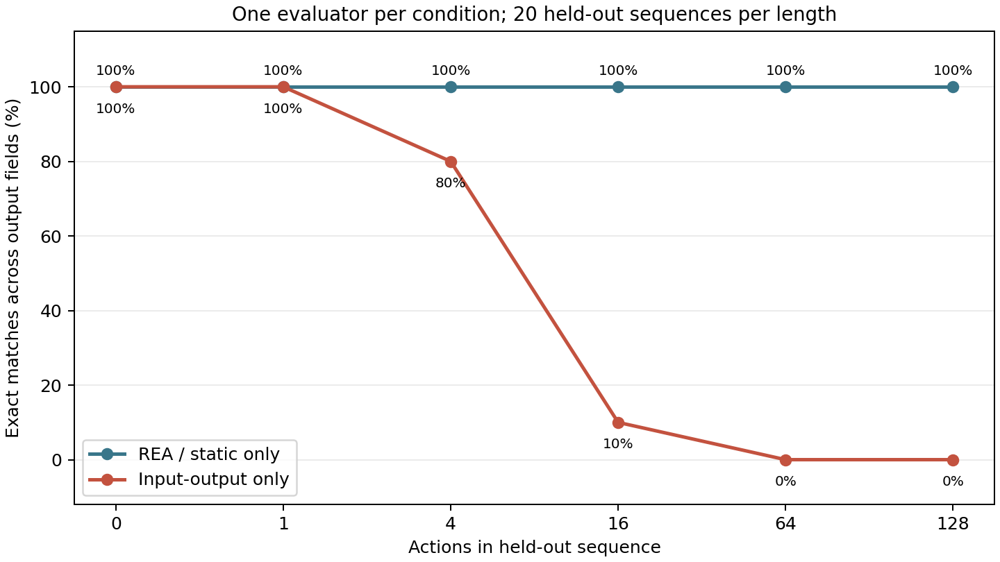

# Stateful Game Observations: REA, Input-Output Access, and Memory

2026-10-28 · Public research record. Internal experimental code and executables remain private.

## Purpose and conditions

A small game-logic sample changes enemy state, health, and score based on previous actions. The study examined differences in information available to an investigator. The target was an **unprotected CLI executable**, not a complete game. Inputs were an initial seed and action string; outputs were health, score, position, and action count. Enemy and RNG state were not printed.

- Static condition: one separate evaluator used REA/Ghidra. Executing the target or using GDB was prohibited.
- Input-output condition: another evaluator could only observe execution results. Binary analysis and memory inspection were prohibited, with a budget of 200 target queries.
- Memory observation: the source-aware primary investigator separately observed a debug-symbol build twice using GDB. This was a qualitative observation, not a blind reconstruction trial comparable to the other conditions.

Evaluators received no source or conversation history and were instructed not to read outside their folders. File access was not restricted by the OS. Each condition had one evaluator and one attempt, with different budgets. The input-output evaluator used a 200-query limit; the static evaluator had no equivalent tool-call limit. Both ran concurrently on the same host. These differences cannot establish general tool performance or protection effectiveness.

## Held-out agreement

The primary investigator generated seeds and actions that were not provided to the evaluators: 20 sequences at each length, 120 in total. The four fields of the reconstructed and original JSON outputs were compared.

| Action count | REA static analysis | Input-output only |
| ---: | ---: | ---: |
| 0 | 20/20 | 20/20 |
| 1 | 20/20 | 20/20 |
| 4 | 20/20 | 16/20 |
| 16 | 20/20 | 2/20 |
| 64 | 20/20 | 0/20 |
| 128 | 20/20 | 0/20 |

The REA evaluator reconstructed the behavior without running the target. The input-output reconstruction was incomplete: health and score diverged on long sequences, while position and action count matched throughout this sample. Reproducing some observable fields and recovering a complete state transition are different goals. Visual similarity or complete game copying was not measured.

## Memory observation

GDB read internal fields such as `rng`, `threat`, and `combo` before and after one action in a debug-symbol build. Because the investigator had source and symbols, this is not evidence that a stripped distribution binary can be inspected with the same effort. It does establish that unprinted state existed in memory and was readable in this setup. This observation does not demonstrate a protection bypass or a new vulnerability.

## Interpretation and next steps

Limited input-output queries did not fully recover this particular transition, while static REA analysis reproduced the unprotected binary on held-out samples. Hidden state alone therefore did not prevent analysis here. Static, dynamic, and input-output conditions need further tests with clearly stated access and budgets. Generalization to commercial games requires stronger source isolation, multiple evaluators and models, repeated trials, broader game samples, and varied attack budgets. This is an observation before protection, not a measurement of copy resistance.
