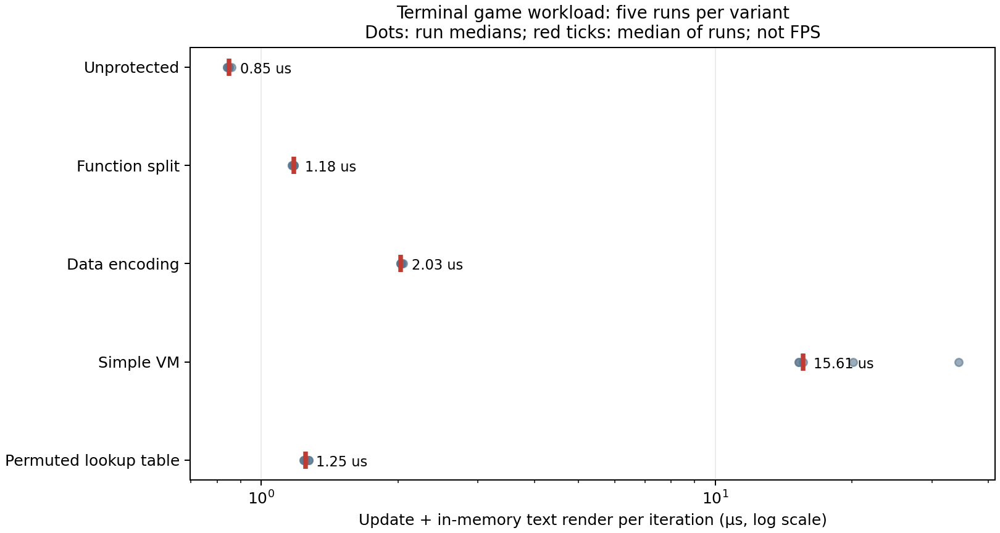

# Permuted Lookup-Table Candidate: Preliminary Study

2026-10-28 · Public research record. Experimental code and binaries remain private.

## Idea and scope

The small game's collision calculation was replaced with a precomputed table whose index order and result representation were changed. The question was whether this would make the collision rule harder to recover from executable code. The transformation was applied manually to this specimen, not implemented as a general game protector. Both the table and its access code remain in the executable and can be extracted or investigated through input-output observations.

Table-based protection and data encoding are established research areas; novelty has not been demonstrated. References include the [layered-obfuscation taxonomy](https://link.springer.com/article/10.1186/s42400-020-00049-3) and the [ASPIRE data-obfuscation report](https://www.aspire-fp7.eu/sites/default/files/D2.01-ASPIRE-Early-White-Box-Cryptography-and-Data-Obfuscation-Report-v1.01.pdf).

## Correctness and performance

The baseline and candidate agreed on 1,004 boundary and random inputs. Final screens after 500 scripted game inputs and final benchmark state also agreed. These checks do not establish correctness for all inputs or all game features.

| Technique | Median update and in-memory frame generation | Median 95th percentile |
| --- | ---: | ---: |
| Unprotected | 0.85 μs | 0.94 μs |
| Function splitting | 1.18 μs | 1.52 μs |
| Encoding | 2.03 μs | 2.10 μs |
| Simple VM | 15.61 μs | 39.03 μs |
| Table candidate | 1.25 μs | 1.31 μs |

The workload used 200 enemies and 6,000 game updates per run, with five randomly ordered runs on WSL2 and GCC 15.2.0 `-O2`. Output, input waiting, and actual display work were excluded. These are not FPS or engine-wide performance results. The candidate/baseline median ratio was approximately 1.47×. Performance measurement and REA analysis ran separately.

Section sizes reported by `size` totaled 2,432 bytes for the unprotected executable and 11,924 bytes for the candidate; these are loaded-section totals rather than ELF file sizes. One table-generation measurement was 5.407 ms. Five debug compile/link runs had medians of 175.6 ms for baseline and 182.2 ms for candidate, excluding generation and game integration. This small-project measurement cannot represent total development effort. GDB breakpoints and call stacks were checked; real-engine integration, difficult debugging, and original-source mapping were not.

## Separate REA reconstruction

An evaluator without the original source or previous conversation used REA/Ghidra to examine table access, extracted the executable's table, and embedded it in a separate program. The reconstructed program did not access the original executable at runtime. Its stdout and exit code matched on 305 evaluator test inputs and another 260 separately generated inputs. This demonstrates reproduction using the table, not necessarily a complete explanation of the rule represented by it.

The evaluator reported approximately 71 seconds, but this was one trial without a simultaneous controlled baseline. It cannot establish a timing difference from other techniques. Folder restrictions were instruction-based rather than OS-enforced. The target was a single logic binary, not a whole game, and full-input equivalence was not proved.

**Conclusion:** this particular prototype failed to prevent reproduction because its table could be extracted and reused. It had lower update costs than the simple VM in this workload, but better protection was not demonstrated. The result does not assess all table-based techniques or their combinations.
