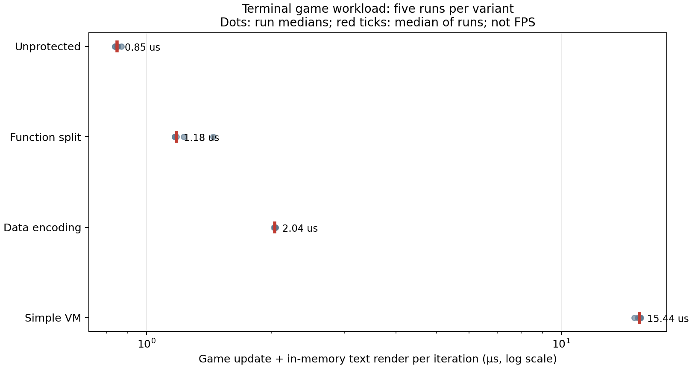

# 오프라인 터미널 게임 예비 실험

2026-10-28 · 공개 연구 기록. 게임과 실험 코드는 공개 대상이 아니다.

## 대상 및 방법

숫자 입력으로 플레이어를 이동시키는 작은 텍스트 게임에 보호 없음, 수동 함수 분리, 수동 데이터 인코딩, 기존 단순 VM 네 가지 로직을 별도 링크했다. 충돌 점수와 200개 적 업데이트를 수행한다. 플레이어가 한 번에 명령을 입력하는 턴 기반 터미널 게임이며 상용 게임 엔진이나 3D 게임이 아니다. 보호 도구가 임의의 게임에 적용되는지를 시험한 것은 아니다.

자동 입력 500회 후 화면은 네 버전에서 동일한 SHA-256을 보였다. 보호 없는 버전에 대해 입력 1, 종료 q로 대화식 입출력이 실행되는 것도 확인했다. 자동 성능 실행에서는 체력이 바닥나면 다시 시작해 6,000회 업데이트를 수행했다. 네 버전의 최종 상태와 재시작 수는 일치했다. 전체 동작을 완전히 검증한 것은 아니다.

## 게임 루프 측정

WSL2, GCC 15.2.0 `-O2`에서 버전별 5회, 무작위 순서로 실행했다. 매회 6,000번의 업데이트와 메모리 내 텍스트 화면 생성 시간을 측정했다. 터미널 출력, 사용자 입력 대기, 운영체제 화면 표시, 그래픽 렌더링은 포함하지 않는다. 아래는 매 실행의 중앙값과 95백분위수의 중앙값이며 마이크로초다.

| 버전 | 중앙값 | 95백분위수 | 중앙값의 기준 대비 |
| --- | ---: | ---: | ---: |
| 보호 없음 | 0.85 μs | 1.16 μs | 1.00배 |
| 함수 분리 | 1.18 μs | 1.59 μs | 1.39배 |
| 데이터 인코딩 | 2.04 μs | 2.73 μs | 2.40배 |
| 단순 VM | 15.439 μs | 39.13 μs | 18.16배 |

점은 각 실행의 중앙값이고 빨간 표식은 5회 중앙값이다. 가로축은 로그 눈금이다. 해당 수치는 FPS나 실제 화면 프레임 시간이 아니며 스케줄링 등으로 변동할 수 있다. 게임 로직과 작업량이 작고 반복적이므로 다른 게임의 성능을 예측할 수 없다. VM 측정용으로 내부 함수를 외부 링크 가능하도록 바꿨다.

## 개발자 영향

디버그 심볼을 포함한 실험 빌드를 각 5번 컴파일·링크한 시간의 중앙값은 보호 없음 189.4ms, 함수 분리 182.9ms, 인코딩 185.4ms, VM 221.0ms였다. 짧은 단일 프로젝트의 변동이 크고, 수동 변환·시스템 설정·검증 비용은 빠져 있어 도입 비용의 비교로 사용하면 안 된다.

GDB에서 네 버전의 로직 진입 중단점과 게임 호출 스택을 확인했다. VM은 생성된 해석기 소스에서 멈췄다. 원본 로직으로의 디버그 매핑, 복잡한 버그 추적, 빌드 파이프라인, 업데이트와 엔진 호환성은 미측정이다. 보안용 배포 바이너리는 별도로 디버그 심볼을 제공하지 않는 조건이므로 이 디버그 시험과 구분해야 한다.

## 블라인드 재구현 상태

별도 평가자 둘에게 각기 보호 전과 단순 VM의 기존 로직 바이너리와 입출력 형식만 전달했다. 둘 다 REA/Ghidra를 사용했고 각자 재구현물을 작성했다. 주 평가자가 별도로 생성한 정수 입력 260개에서 두 재구현 모두 원본과 종료 코드·표준 출력이 일치했다. 평가자가 준비 과정에서 사용한 입력과는 별도 생성했으나, 입력 전체 공간의 증명은 아니다. 대상은 이 문서의 전체 게임이 아니라 기존 단일 함수의 CLI 실행 파일이다.

평가자가 보고한 시작부터 자체 검증까지 소요 시간은 보호 전 약 75초, VM 약 84초다. **각각 1회뿐이고 동시에 같은 컴퓨터의 REA/Ghidra 자원을 공유했으므로 시간을 보호 효과의 비교 지표로 해석할 수 없다.** 다른 평가자와 여러 회차, 균일한 모델·환경·시간·자원 제한이 필요하다. 평가자에게 이전 대화 기록과 소스를 제공하지 않고 지정된 폴더 외부를 읽지 않도록 지시했지만 운영체제 수준의 접근 차단은 적용하지 않았다. 사전 학습 오염도 검증하지 않았다.

단순 VM은 평가자의 재구현을 막지 못했다. 함수 분리·데이터 인코딩에 대한 블라인드 비교와 게임 전체 재구현은 아직 수행하지 않았다. 기존 소스를 알고 진행한 예비 결과는 [이전 결과](RESULTS_EXISTING_METHODS.md)에 별도 기록되어 있다.

내부 코드·바이너리와 실험 자료는 GitHub에 올리지 않았다. 공개 시에는 결과 문서와 허용된 시각 자료만 별도 검토한다.
